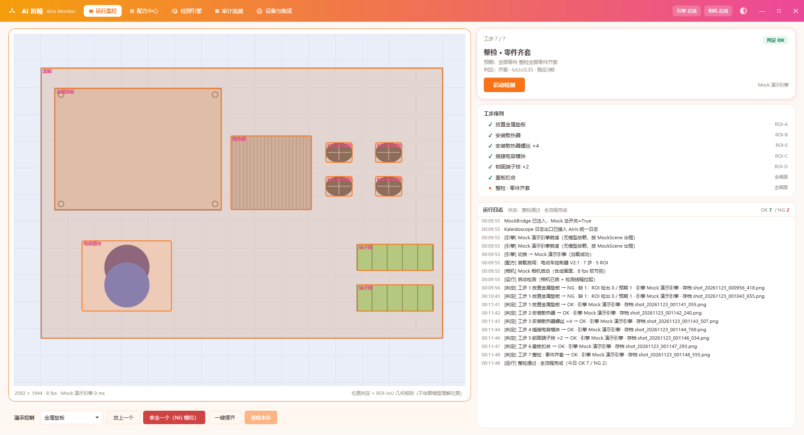
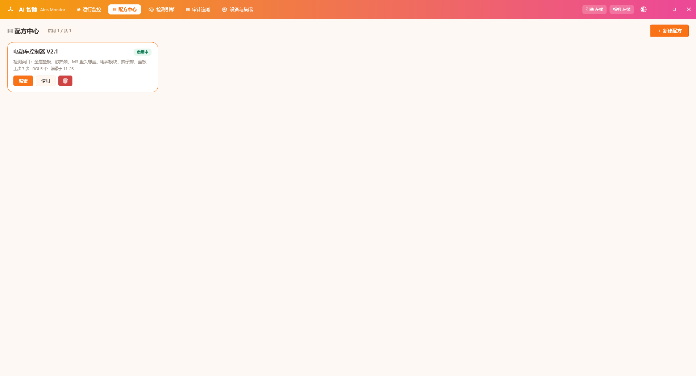
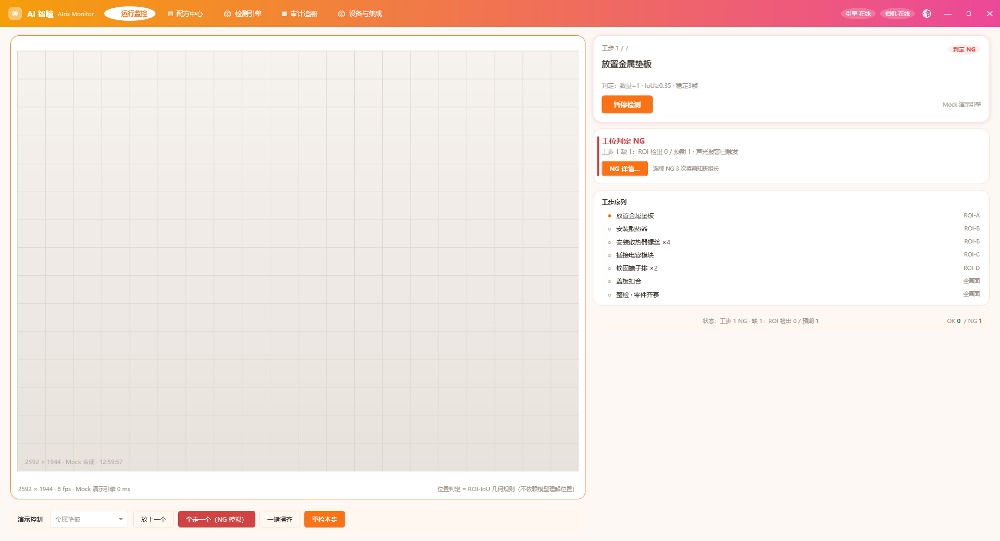
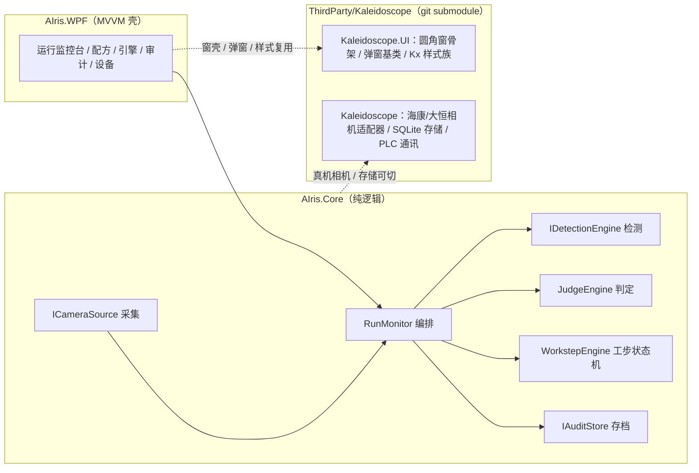

<div align="center">

# AIris（AI 智瞳）

**一句话教会 AI 盯现场 —— 自然语言驱动的通用视觉检测与防错平台**


相机盯着工位，用**自然语言 + 配方**告诉 AI 检测什么、怎么判定，输出工步引导与 OK/NG 防错判定，
全部本地离线部署。装配防错是首个落地场景，同一套引擎适配安全监控、缺料提醒、SOP 合规等广泛场景。

</div>

---

## 快速开始

```powershell
# 0) 克隆（含 Kaleidoscope submodule）
git clone --recurse-submodules https://github.com/lq700212/AIris.git

# 1) 构建（WPF 主工程，Core 自动级联；增量构建漏编新文件时删 obj 后 -t:Restore,Build 整编）
& "D:\Program Files\Microsoft Visual Studio\18\Enterprise\MSBuild\Current\Bin\MSBuild.exe" "AIris.WPF\AIris.WPF.csproj" /p:Configuration=Debug /p:Platform=AnyCPU /t:Build /nologo /v:m

# 2) 运行（输出兼运行目录 00_ExeBuild\）
.\00_ExeBuild\AIris.WPF.exe

# 3) 回归探针（改动判定逻辑后必跑）
powershell -File Tools\probe_ng_semantic.ps1
```

> 运行目录 `00_ExeBuild\` 下的配方/审计存档/MainSetting.ini 是现场数据，不入库；
> PLC 通讯的 HslCommunication 授权文件（HslLicense.dat / hsl.dat）按内部流程部署到运行目录。

## 界面速览

| 运行监控台 —— 画面叠加 + 工步引导 + NG 告警 | 配方中心 —— 每产品一份配方，零代码换型 |
| --- | --- |
|  |  |
| **检测引擎** —— 可插拔引擎卡 + 许可证直标 | **审计追溯** —— 每步截图存档，客诉举证直接调档 |
|  |  |
| **设备与集成** —— 相机 / 光源 / 引导屏 / 声光 / MES | |
|  | |

## 特性

- **自然语言配方**：预期零件用一句话描述（如"4 颗 M3 盘头螺丝"），改这句话就换检测目标，零标注训练；
- **确定性判定**：位置判定走 ROI-IoU 几何规则 × 数量校验 × 连续 N 帧稳定，不依赖模型"理解"位置，可审计；
- **引擎可插拔**：POC 用 LocateAnything-3B 摸效果上限，产品化切 Qwen2.5-VL-7B（Apache 2.0），许可证状态直接写在引擎卡上；
- **工步状态机**：按配方步序引导装配，OK 自动推进 / NG 挂起告警 / 人工重检闭环；
- **质量追溯链**：每个工步判定自动截图存档（JSONL 按天 + PNG），规则快照随档可复核；
- **全流程可演示**：内置 Mock 相机 + Mock 检测引擎 + 演示控制条，无硬件即可演示完整防错闭环；
- **明暗双主题**：C 方案「熔金流场」视觉体系，顶栏 🌓 一键切换。

## 架构



- **检测引擎是唯一接入面**：真实模型接入 = 实现 `IDetectionEngine`（或填实 `HttpDetectionEngine` 的服务调用），UI/判定/审计零改动；
- **相机同理**：真机实现 `ICameraSource`（或包一层 Kaleidoscope 相机适配器），Mock 三件套保留作演示与回归；
- **壳与控件复用**：主窗圆角骨架（分层真圆角 + 最大化归零）、弹窗基类、Kx 样式族全部来自 submodule `ThirdParty/Kaleidoscope`（Kaleidoscope.UI），AIris 只写页面与主题；Kaleidoscope 主库的相机适配器 / 存储 / 通讯是 Core 层真机接入时的现成选件。

## 大模型接入（留桩说明）

检测引擎尚未接入（V0.1.0 全流程由 Mock 三件套驱动）。与推理服务约定一个 HTTP 契约即可完成接入，
请求/响应格式与改造点见 [`AIris.Core/Detection/HttpDetectionEngine.cs`](AIris.Core/Detection/HttpDetectionEngine.cs) 文件头注释：

- 请求：`{ "model", "prompts", "image_b64" }` → POST `/detect`；
- 响应：`{ "ok", "detections": [{ "label", "x1", "y1", "x2", "y2" }] }`（坐标 0~1000 归一化，不含置信度）。

## 目录树

```text
AIris/
├── AIris.Core/            # 纯逻辑层：模型 / 检测引擎 / 相机 / 判定 / 工步 / 存储
├── AIris.WPF/             # WPF 主工程（MVVM：Views/ViewModels/Services/Styles）
├── ThirdParty/Kaleidoscope/  # git submodule：自研通讯库 + WPF 控件库（UI 复用）
├── docs/                  # 调研报告 + UI 设计稿（C 方案落地蓝本）+ images/
├── Tools/                 # 回归探针 + PrintWindow 截图脚本 + 目检素材
└── 00_ExeBuild/           # 编译输出兼运行目录（配方/审计/INI 现场数据，不入库）
```

## 文档导航

| 文档 | 说明 |
| --- | --- |
| [AIris 调研报告](docs/AIris调研报告.md) | 模型选型 / 许可证风险 / 推理框架 / 硬件三档 / 通用化架构（九章节） |
| [UI 设计稿](docs/ui_design_mockups.html) | 5 方案 × 明暗主题可交互工作台（本仓库落地的是 C 方案「熔金流场」） |
| [AGENTS.md](AGENTS.md) | AI 助手工程指南（铁律 / Mock 三件套 / 构建与验证命令） |

## 配置

配置集中在运行目录 `00_ExeBuild\MainSetting\MainSetting.ini`（设备/引擎/主题开关），
全部有缺省值，缺文件自动回缺省；配方在 `Data\Recipes\`（JSON）、审计在 `Data\Audit\`。
逐键语义见 [`AGENTS.md`](AGENTS.md) 与「设备与集成」「检测引擎」两页界面。
